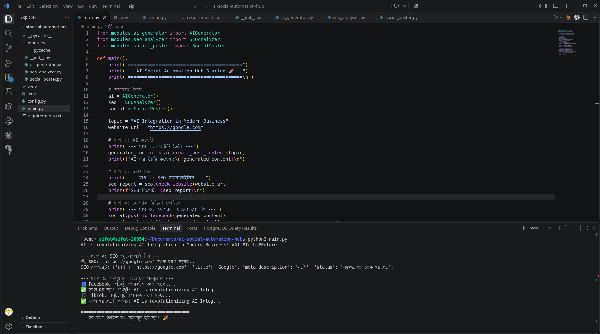
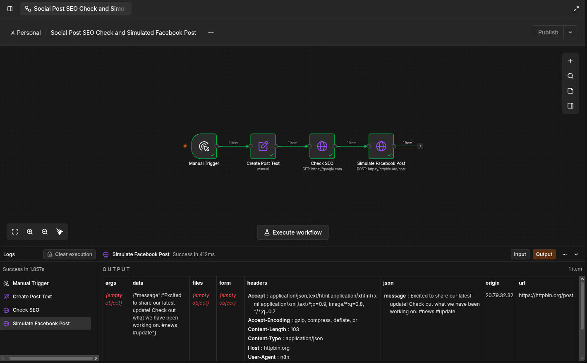

# AI Social Automation Hub 

This project demonstrates an end-to-end AI integration and social media automation pipeline.

## ️ Technologies Used
- Python 3
- OpenAI API
- BeautifulSoup (SEO Analysis)
- n8n (Visual Workflow Automation)
- REST APIs (HTTP GET/POST)

## 📸 Project Demonstrations

### 1. Python Automation Pipeline
The Python script runs a modular pipeline: AI Content Generation → SEO Audit → Social Media Posting Simulation.

### 2. n8n Visual Workflow
A drag-and-drop workflow in n8n that automates the same process visually, reducing development time.

##  How to Run
1. Clone the repository
2. Install dependencies: `pip install -r requirements.txt`
3. Run the script: `python3 main.py`